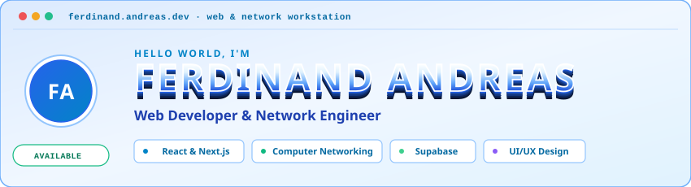
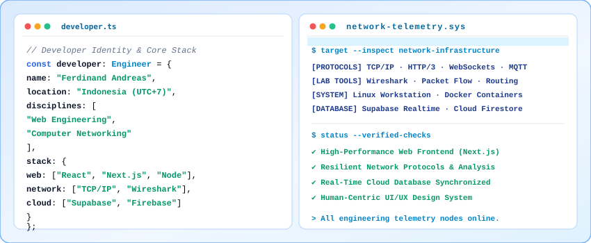

  

---

### About Me

Hi, I am **Ferdinand Andreas Saputra** (`@FerdinandAndreas`), a Computer Science student and software engineer specializing in **Web Engineering**, **Computer Networking**, and **UI/UX Design**.

I design and build end-to-end digital solutions: from crafting user-centric design systems and modern web interfaces to engineering robust network architectures, real-time databases, and connected mobile and IoT systems.

- **Web Engineering**: Building fast, accessible, and performant web applications with **React**, **Next.js**, **Node.js**, and modern frontend standards.
- **Computer Networking**: Analyzing network topologies, traffic flows, packet data, and implementing reliable communication protocols.
- **UI/UX Design**: Creating wireframes, interactive user journeys, and scalable design systems in **Figma**.
- **Databases &amp; Cloud**: Integrating real-time and document-based cloud backends using **Supabase**, **Firebase**, and **NoSQL**.
- **Mobile &amp; IoT**: Developing cross-platform mobile apps (**Flutter**, **Kotlin**) and microcontrollers (**ESP32**, **Arduino**).

---

  

---

### Technical Arsenal &amp; Stack

#### Web &amp; Frontend

  
  
  
  
  
  
  

#### Computer Networking &amp; Systems

  
  
  
  
  

#### Databases &amp; Cloud Backends

  
  
  
  
  

#### UI/UX &amp; Design Tools

  
  
  
  

#### Mobile &amp; IoT

  
  
  
  
  

---

### GitHub Activity &amp; Live Metrics

  
  

---

### Connect &amp; Collaborate

I am always open to discussing web engineering projects, network architecture research, and UI/UX design opportunities.

  
  
  

