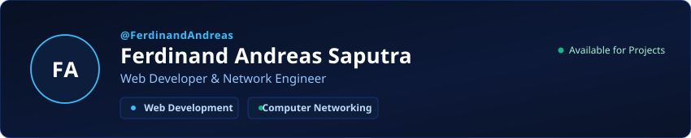
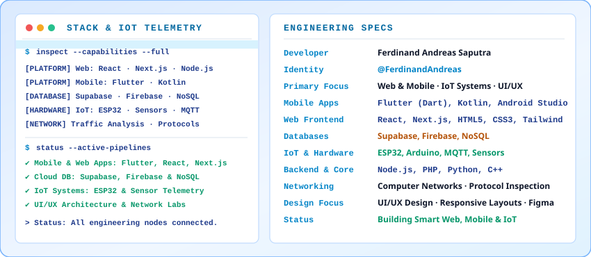

  

  

---

### About Me

Hi, I am **Ferdinand Andreas Saputra** (`@FerdinandAndreas`), a Computer Science student and developer focused on **Mobile &amp; Web Development**, **IoT (Internet of Things)**, **Computer Networking**, and **UI/UX Design**.

I build integrated digital solutions from hardware to cloud and user interfaces: connecting microcontrollers and sensors to modern cloud databases, crafting intuitive UI/UX designs, and building responsive mobile and web applications.

- **Mobile Development**: Crafting cross-platform mobile apps with **Flutter** and native Android apps with **Kotlin**.
- **Web Development**: Building modern full-stack web applications using **React**, **Next.js**, **Node.js**, **PHP**, and modern web standards.
- **IoT &amp; Embedded Systems**: Interfacing microcontrollers (ESP32, Arduino, Raspberry Pi), sensor telemetry, and lightweight protocols like MQTT with real-time dashboards.
- **Databases &amp; Cloud**: Managing and integrating real-time backends with **Supabase**, **Firebase**, and **NoSQL** architectures.
- **Computer Networking**: Analyzing data flow, network protocols, system architectures, and reliable communications.
- **UI/UX Design**: Designing design systems, wireframes, and interactive user prototypes focused on clarity and ease of use.

---

  

---

### Technical Arsenal &amp; Stack

#### Mobile Development

  
  
  
  

#### Web &amp; Frontend

  
  
  
  
  
  
  

#### Databases &amp; Cloud Backends

  
  
  

#### IoT &amp; Embedded Hardware

  
  
  
  

#### Backend &amp; Core Languages

  
  
  
  

#### Networking &amp; Systems

  
  
  
  
  

#### UI/UX &amp; Design Tools

  
  
  
  

---

  

---

### Connect &amp; Collaborate

I am always open to collaborating on web, mobile, IoT hardware integrations, and UI/UX design projects.

  
  
  

